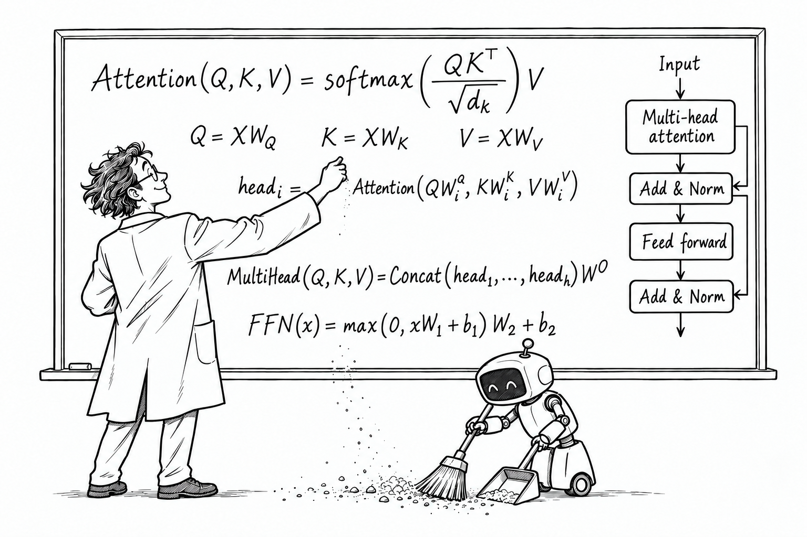

# SciSkill

**Agent skills and tools for scientists.**

Keep your focus on the science. Let your agent handle the grunt work.



## Run the tools

Requires [uv](https://docs.astral.sh/uv/) and Python 3.12 or newer. Run the published [SciSkill package from PyPI](https://pypi.org/project/sciskill/):

```sh
uvx --prerelease allow sciskill --help
uvx --prerelease allow sciskill bib-lint verify /path/to/references.bib
uvx --prerelease allow sciskill bib-lint view /path/to/references.bib-lint
uvx --prerelease allow sciskill rebuttal import-openreview /path/to/discussion.html /path/to/my-rebuttal
uvx --prerelease allow sciskill rebuttal view /path/to/my-rebuttal
```

Both tools and their browser assets are bundled. Dependencies stay outside your paper's environment; no repository checkout is needed. The prerelease flag selects the alpha release.

See [bib-lint](tools/bib-lint/README.md) and [Rebuttal Desk](tools/rebuttal-desk/README.md) for inputs, outputs, and limitations.

## Agent skill

```sh
npx skills add Am1n3e/sciskill
```

The [SciSkill instructions](skills/sciskill/SKILL.md) define the `plan-rebuttal` workflow: analyze initial reviews against the manuscript, annotate actionable passages, and produce linked themes and proposed tasks. The author reviews decisions and writes the response drafts.

For repository development, checks, website setup, and release instructions, see [Contributing](CONTRIBUTING.md).

## License

SciSkill tools and agent skills are licensed under [MIT](LICENSE). The website retains [GPL-3.0](website/LICENSE) because it adapts Astroship; the template was modified on 18 October 2026.
