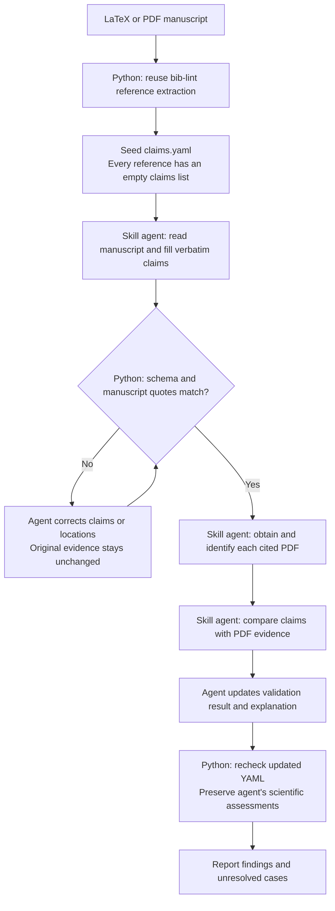
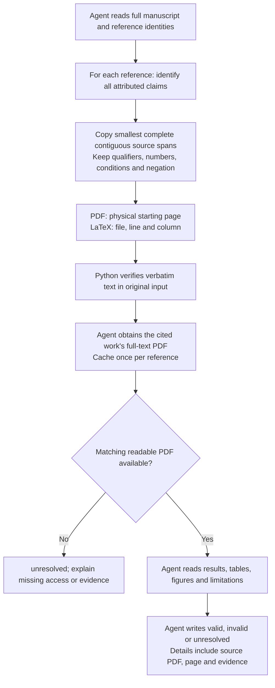

# Spec: Citation claim checks

Status: Skill-owned extraction and comparison, with local reference and quote checks.

## Scope

The skill agent identifies citation-associated claims and compares them with cited
PDFs. Python reuses bib-lint's reference extraction to seed YAML, then validates
agent-written claim text against the original manuscript. Python never launches
a model CLI/SDK or performs semantic support assessment.

## Commands

```sh
# Existing reference correctness workflow.
uvx sciskill bib-lint check-references references.bib

# Seed references and empty claims for the skill agent.
uvx sciskill bib-lint check-claims main.tex --bib references.bib --output paper-claims --json
uvx sciskill bib-lint check-claims paper.pdf --output paper-claims --json

# Check the agent-filled YAML against the original manuscript.
uvx sciskill bib-lint check-claims paper-claims/claims.yaml --json
```

- One user-facing skill action, `bib-lint check-claims`, runs the full workflow.
  The same local command accepts a manuscript to seed or a YAML report to check.
  There are no preparation/finalization subcommands or `--model` option.
- Seed inputs: `.tex`, text-based `.pdf` (including `.PDF`), or a project directory
  containing `main.tex`. YAML checks accept `.yaml`/`.yml` within a seeded workspace.
- `--bib PATH` is repeatable, LaTeX-only; literal bibliography declarations are
  discovered when omitted. The agent may pass configured project paths explicitly.
- `--project-root PATH` bounds LaTeX includes and defaults to the entry file's parent.
- `--output DIRECTORY` applies only when seeding. Default: configured project cache
  `.sciskill/cache/bib-claims`, otherwise `<input-stem>.bib-claims` beside the input.
- `--mode agent` is the default for seeding; YAML checks preserve its declared mode.
  An explicit mode on a check must match the report. `stub` remains an official
  testing validator. Both validators are imported directly by name; no registry.
- `--json` emits one result on stdout; diagnostics go to stderr. Seeding returns
  `status: awaiting_agent`. Successful YAML checks return `status: quotes_checked`.
  Neither result certifies scientific completion; no `complete` or `stage` fields.

| Module contract | Interface |
| --- | --- |
| `Extractor` | `extract(Request) -> Extraction`: local source/reference readers and a loader/checker for agent-authored YAML. No semantic claim generation. |
| `Validator` | `validate(Claim, citation_key) -> Validation`. `agent` preserves the agent's assessment; absent assessments are unresolved. `stub` always returns valid. |
| Skill | Owns claim attribution, cited-PDF retrieval, scientific comparison and YAML assessment updates. |

## Process



## Agent extraction and comparison



- References come from the existing BibTeX parser or PDF bibliography extractor.
  Seed every extracted reference, including those without manuscript claims.
  Keep reference metadata privately for the agent's identity/PDF lookup.
- Only the agent chooses claims. Citation groups may share a claim ID; repeated
  manuscript occurrences have separate IDs. Preserve exact text and source scope.
- The quote check concerns the input manuscript, not a demand that its paraphrase
  appear verbatim in the cited paper. It reads original inputs again, rejects
  changed sources and invented/normalized quotes, and checks the stated location.
- The agent retrieves each cited PDF using available authorized tools, confirms
  work/version identity, caches it privately, and records local paths/URLs.
  Unavailable full texts remain unresolved. No automatic downloader or model
  backend is added to the Python tool.
- Agent comparison accounts for numerical values, metric/dataset/conditions,
  source qualifications and attribution. Details identify evidence and its page.
  A programmatic quote check does not perform that semantic comparison.

## Output contract

`claims.yaml` has **exactly** these top-level fields. No extra public fields.

| Field | Contract |
| --- | --- |
| `schema_version` | Integer `1`. |
| `scikill_version` | Installed SciSkill package version, or standalone bib-lint version when SciSkill is not installed. |
| `document` | Exactly `kind` (`latex` or `pdf`), `path`, and original input `sha256`. The document is identified once. |
| `setup` | Exactly `validation_mode`: `agent` for skill assessments or `stub` for tests. |
| `citations` | List of objects containing exactly `citation_key` and `claims`. |

Each claim contains exactly `claim_id`, `claim`, `location`, and `validation`.
`claim` is verbatim manuscript text. `validation` contains exactly `result`
(`valid`, `invalid`, or `unresolved`) and nonempty explanation `details`.
Group membership supplies the citation key; shared claim IDs identify the same
manuscript occurrence. A resolved cited reference with no claims has `claims: []`.
Use minimal complete contiguous spans. A verdict concerns assertions attributed
to that reference; necessary context about other sources or the manuscript's own
work does not become an assertion this source must independently establish.

PDF example in explicit testing mode:

```yaml
schema_version: 1
scikill_version: "0.1.0"
document:
  kind: pdf
  path: main.pdf
  sha256: 4589d5e4479c938170f8cfb72d1091add21083737a2cbea0a0fec6d24385a9c7
setup:
  validation_mode: stub
citations:
  - citation_key: smith2024
    claims:
      - claim_id: claim-0001
        claim: "Method X improves accuracy."
        location:
          page: 3
        validation:
          result: valid
          details: "Stub mode."
```

LaTeX uses the same header with `kind: latex`, its entry path/hash, and this claim:

```yaml
claim_id: claim-0001
claim: "Method X improves accuracy."
location:
  file: sections/results.tex
  start: {line: 12, column: 1}
  end: {line: 12, column: 28}
validation:
  result: valid
  details: "Stub mode."
```

| Location contract | Required fields |
| --- | --- |
| PDF | Exactly `page`: the one-based physical page where the quoted text starts, including cross-page quotes. No file, line, column, or bounding boxes. |
| LaTeX | Exactly `file`, `start`, and `end`. Each endpoint contains only one-based `line` and `column`; the end is exclusive. Columns count Unicode code points. No page number. |

PDF quotations follow captured reading order; cross-page spans may retain
intervening footers/footnotes, identified in the agent's review notes.

No `extract_command`, `sources`, `extraction`, parser settings, page dimensions,
snapshot paths, or geometry in `claims.yaml`. Keep internal evidence and snapshots
under `.provenance/`; its contents are not part of the public report contract.
Retain real source-fidelity, hash, and geometry checks internally.

`summary.md` and command JSON expose meaningful counts, extraction state and review
findings, with locations using the same PDF/LaTeX conventions. Technical extraction
metadata stays private. A rejected or unresolved citation remains a review finding;
do not invent a citation key or claim to hide it.
When present, link `review-notes.md` from the regenerated summary for agent-reviewed
coverage, source-format limitations and manual inspection findings.

IDs are assigned in document order. Shared claim IDs have the same text/location;
validation remains specific to each reference. Repeated document occurrences have
separate IDs. Source changes invalidate captured evidence. Publish the report,
summary and private evidence together; failure preserves previous complete output.

## Validation modes

- `agent`: retain the agent-written `valid`, `invalid` or `unresolved` result and
  its nonempty explanation. Python checks text/schema fidelity and does not
  rewrite the scientific assessment.
- `stub`: official testing mode, retained for future validators. Every pair must
  have `result: valid`, `details: Stub mode.`. It never bypasses quote/schema checks.
- Initial skill-authored claims are unresolved until cited-PDF comparison occurs.
  Unknown modes fail explicitly; mode overrides cannot silently relabel a report.

## Completion and acceptance

- The action result includes status (`awaiting_agent`, `quotes_checked`, `failed`, or `interrupted`),
  artifact paths, source-capture state, validation mode, counts, and errors.
  A successful local check does not imply the skill has finished cited-paper review.
- Shell exit codes are `0` for success, `2` for input/artifact errors, and `130`
  for interruption.
- Count unique claims separately from claim–citation pairs. Also report reference
  keys, references without claims, assessment totals per pair, and available
  extraction diagnostics. Citation-attribution coverage is reviewed by the agent;
  empty claim lists do not establish that every manuscript citation was examined.
- Publish only structurally valid artifacts. Failure or interruption preserves
  inputs and the agent-authored YAML. A successful YAML check writes a private
  report-hash checkpoint and refreshes the summary; it does not rewrite the YAML.
- Reject duplicate keys, malformed schemas/locations/results, missing references,
  stale source hashes, and unsafe paths. Stub mode never bypasses these checks.
- Acceptance covers LaTeX/PDF seeding, agent edits, exact quotation rejection,
  preserved assessments, selectable stub mode, installed commands, and an independent
  skill workflow exercise. Local checks do not measure semantic extraction recall.

Deferred Python features: automatic scientific support reasoning, automatic PDF
downloads, OCR, arbitrary TeX expansion, PDF-to-BibTeX reconciliation, and a new
viewer. The skill agent owns cited-PDF acquisition and evidence assessment now.
