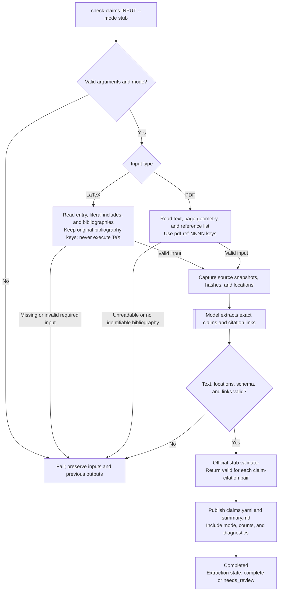
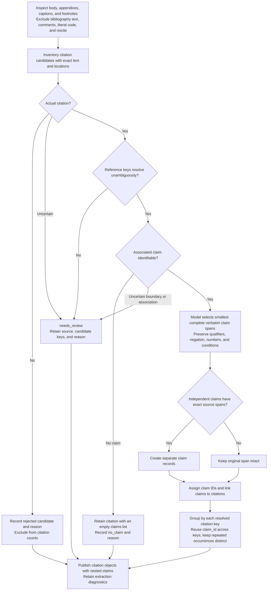

# Spec: Citation claim checks

Status: Implemented; model-based extraction exercised on the supplied manuscript.

## Scope

Extract every citation-associated claim from a LaTeX or text-based PDF manuscript.
Save verbatim claims grouped by citation key, with source locations. Run claim
validation in the official `stub` testing mode, which returns `valid` for every
extracted claim–citation pair.

Cited-paper retrieval and actual support assessment are outside this version.

## Commands

```sh
# Reference identity and bibliographic correctness; replaces verify.
uvx sciskill bib-lint check-references references.bib
uvx sciskill bib-lint check-references paper.pdf

# Extract claims and validate in testing mode.
uvx sciskill bib-lint check-claims main.tex --bib references.bib --mode stub
uvx sciskill bib-lint check-claims paper.pdf --mode stub

# Optional output directory and machine-readable result.
uvx sciskill bib-lint check-claims paper.pdf --mode stub --output ./claims --json
```

- Standalone `bib-lint` uses the same action names. No `verify` compatibility alias
  is required. Existing reference-checking behavior and `view` remain unchanged.
- The agent skill exposes `/sciskill bib-lint check-references INPUT` and
  `/sciskill bib-lint check-claims INPUT`, with the same applicable options.
- `check-claims` is one action. No public preparation/finalization commands or
  user-supplied intermediate drafts.
- `INPUT` is a `.tex` entry file or a text-based `.pdf`; uppercase `.PDF` and paths
  containing spaces are supported.
- `--bib PATH` is repeatable and LaTeX-only. At least one bibliography is required
  for LaTeX; the agent may resolve it from `.sciskill/config.yaml`.
- `--project-root PATH` is LaTeX-only and defaults to the entry file's parent.
  Included source files must stay within that root.
- `--output DIRECTORY` defaults to `.sciskill/cache/bib-claims` in a configured
  project, otherwise `<input-stem>.bib-claims` beside the input.
- `--mode stub` selects the official testing validator. `stub` is the default and
  only supported mode in this version. Unknown modes fail explicitly.
- `--model MODEL` selects the extraction model independently of validation mode;
  omission uses the configured Codex model, or the CLI default when unconfigured.
  Requires an authenticated Codex CLI.
- `--json` emits one final result on stdout; progress and diagnostics go to stderr.

Extraction is model-based. Local readers capture source text, citation candidates,
and locations; the model selects exact claim spans and citation associations.
The Codex backend receives manuscript text in a tool-disabled, read-only,
ephemeral session. Backend/model failure is an explicit error, never a local
sentence-extraction fallback. Agent and shell calls use the same contract.

| Module contract | Interface |
| --- | --- |
| `Extractor` protocol | `extract(Request) -> Extraction`; the model extractor composes separate LaTeX and PDF source readers. |
| `Validator` protocol | `validate(Claim, citation_key) -> Validation`. |
| Validator selection | Direct import of `bib_lint.claims.validators.<mode>`; `stub` is the exact testing validator name. No registry. |

## Process



## Extraction



| Extraction invariant | Contract |
| --- | --- |
| Coverage | Every candidate is accounted for by extracted claims or a diagnostic with its location and reason. Unsupported forms and unreadable regions retain diagnostics. A supported document without citations may produce an explicit empty result. |
| Identity | LaTeX uses existing exact-first key resolution. PDF resolves numeric groups/ranges and author-year mentions against reference occurrences; original BibTeX keys are not invented. |
| Relationships | One claim may link to multiple citations; one reference may have many claims. Links record attribution, not independent or collective support. |
| Fidelity | Never paraphrase `claim`. Retain the smallest complete verbatim span needed to understand the claim. |

## Output contract

`claims.yaml` has **exactly** these top-level fields. No extra public fields.

| Field | Contract |
| --- | --- |
| `schema_version` | Integer `1`. |
| `scikill_version` | Installed SciSkill package version, or standalone bib-lint version when SciSkill is not installed. |
| `document` | Exactly `kind` (`latex` or `pdf`), `path`, and original input `sha256`. The document is identified once. |
| `setup` | Exactly `validation_mode`, currently `stub`. |
| `citations` | List of objects containing exactly `citation_key` and `claims`. |

Each claim contains exactly `claim_id`, `claim`, `location`, and `validation`.
`claim` is verbatim manuscript text. `validation` contains exactly `result`
(`valid`, `invalid`, or `unresolved`) and nonempty explanation `details`.
Group membership supplies the citation key; shared claim IDs identify the same
manuscript occurrence. A resolved cited reference with no claims has `claims: []`.

PDF example:

```yaml
schema_version: 1
scikill_version: "0.1.0"
document:
  kind: pdf
  path: main.pdf
  sha256: 4589d5e4479c938170f8cfb72d1091add21083737a2cbea0a0fec6d24385a9c7
setup:
  validation_mode: stub
citations:
  - citation_key: smith2024
    claims:
      - claim_id: claim-0001
        claim: "Method X improves accuracy."
        location:
          page: 3
        validation:
          result: valid
          details: "Stub mode."
```

LaTeX uses the same header with `kind: latex`, its entry path/hash, and this claim:

```yaml
claim_id: claim-0001
claim: "Method X improves accuracy."
location:
  file: sections/results.tex
  start: {line: 12, column: 1}
  end: {line: 12, column: 27}
validation:
  result: valid
  details: "Stub mode."
```

| Location contract | Required fields |
| --- | --- |
| PDF | Exactly `page`: the one-based physical page where the quoted text starts, including cross-page quotes. No file, line, column, or bounding boxes. |
| LaTeX | Exactly `file`, `start`, and `end`. Each endpoint contains only one-based `line` and `column`; the end is exclusive. Columns count Unicode code points. No page number. |

No `extract_command`, `sources`, `extraction`, parser settings, page dimensions,
snapshot paths, or geometry in `claims.yaml`. Keep internal evidence and snapshots
under `.provenance/`; its contents are not part of the public report contract.
Retain real source-fidelity, hash, and geometry checks internally.

`summary.md` and command JSON expose meaningful counts, extraction state and review
findings, with locations using the same PDF/LaTeX conventions. Technical extraction
metadata stays private. A rejected or unresolved citation remains a review finding;
do not invent a citation key or claim to hide it.

IDs are assigned in document order. Shared claim IDs have the same text/location;
validation remains specific to each reference. Repeated document occurrences have
separate IDs. Source changes invalidate captured evidence. Publish the report,
summary and private evidence together; failure preserves previous complete output.

## Official stub mode

`stub` is a supported testing mode, retained when real validators are introduced.
It applies to claim-support validation only; extraction and structural artifact
checks still run normally.

- Every structurally accepted claim–citation pair receives `result: valid` and
  `details: 'Stub mode.'`.
- The validator performs no cited-paper or evidence lookups.
- Persist `setup.validation_mode: stub`; per-pair results use that mode.
- The local artifact writer produces validation fields rather than trusting
  agent-supplied results. Invalid artifacts still fail; uncertainty remains visible.
- Do not fabricate pairs for unresolved citations to obtain a `valid` result.
- Summaries and machine results expose the mode. No fixed notice text is required.
  Stub results are testing outcomes, not scientific support verdicts.

## Completion and acceptance

- The action result includes status (`completed`, `failed`, or `interrupted`),
  completion, artifact paths, extraction state, validation mode, counts, and errors.
  Successful execution may retain `extraction.state: needs_review`.
- Shell exit codes are `0` for success, `2` for input/artifact errors, and `130`
  for interruption.
- Count unique claims separately from claim–citation pairs. Also report resolved
  reference keys, actual citation occurrences, no-claim citations, uncertain or
  rejected candidates, unresolved associations, and coverage diagnostics.
- Publish only structurally valid artifacts. Failure or interruption preserves
  previous complete outputs. Inputs are never edited. Repeating the same action
  handles recovery without a separate user-facing command.
- Safe artifact loading rejects duplicate keys, invalid types, broken links,
  unsupported schemas, stale hashes, and unsafe paths. PDF page regions must
  match their text spans and remain within page bounds.
- Acceptance fixtures cover both inputs, grouped/repeated citations, multiple
  claims per reference, multiline/Unicode locations, numerical and compound
  claims, ambiguous mappings, unsupported regions, and empty supported inputs.
- Test exact text/location fidelity, citation groups and nested claims, counts,
  the three allowed result values, nonempty explanations, selectable/default stub
  mode, invalid-mode rejection, and absence of evidence lookups. Stub mode must not
  bypass extraction errors or structural checks.
- Semantic extraction is assessed against independent annotated manuscripts;
  canned drafts alone do not establish extraction quality. Existing reference
  checks and PDF regressions continue to pass after the command rename.

Deferred: actual support assessment, cited-paper evidence quotations, OCR,
arbitrary TeX expansion, PDF-to-BibTeX reconciliation, a new viewer, and editing
manuscripts. A richer review interface remains future work.
